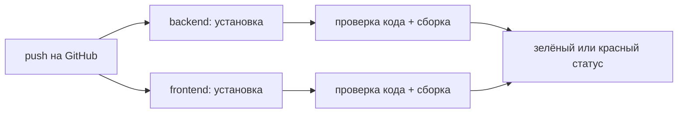

# План: TASK-0014

## Подход

Четыре независимых шага в таком порядке:

1. **Снимок поведения** до правок: эталон для критерия 4 PRD.
2. **Чистая проверка кода:** иначе автопроверка красная с первого дня (research:
   29 ошибок, 8 предупреждений).
3. **Удаление базы, затем образец настроек и документы:** образец описывает то, что
   осталось после удаления.
4. **Автопроверка на GitHub:** последней, когда ей уже есть что показать зелёным.

Правки проверки кода и удаление базы идут отдельными задачами, чтобы сбой сверки
указывал на причину. Принцип `VISION.md`: не смешивать рефакторинг и фичи; новых
функций здесь нет.

Прошлое решение не меняется: `DECISIONS.md:278-280` отвергло `DROP` как необратимый.
Здесь `DROP` нет, Docker-том остаётся на машине человека, схема и миграции — в
истории git.

## Компоненты

| Файл | Новый/Правка | Что делает | Опора (research) |
|---|---|---|---|
| `backend/src/backtest/backtest.dto.ts`, `backtest.service.ts` | Правка | только форматирование | 15 ошибок `prettier/prettier` |
| `backend/src/indicators/indicators.spec.ts` | Правка | форматирование, тип `name` в `:203,206` | 10 + 2 ошибки |
| `backend/src/news/news.translator.ts:29` | Правка | символ U+3000 записан как `　`, смысл регулярки тот же | риск 2 |
| `backend/src/news/news.translator.ts:111-112` | Правка | тип значения из `keys().next()`, поведение то же | `:7` — `Map<string, string>` |
| `backend/src/main.ts:23` | Правка | явно отмеченный незавершённый промис | предупреждение `no-floating-promises` |
| `derivatives.service.spec.ts:380,390,407`, `sources.spec.ts:370,376,587` | Правка | типы в тестах, проверки те же | `no-unsafe-argument` |
| `backend/package.json`, `frontend/package.json` | Правка | команда `lint:check` | `:18` и `frontend/package.json:11` |
| `backend/src/app.module.ts:6,19` | Правка | без `PrismaModule` | «Дальние связи»: других потребителей нет |
| `backend/src/prisma/`, `backend/prisma/`, `backend/prisma.config.ts`, `backend/docker-compose.yml` | Удаление | | таблица research |
| `backend/package.json:13-15,33,34,38,39,53`, `package-lock.json`, `backend/.gitignore:58` | Правка | без команд и зависимостей базы | таблица research |
| `backend/.env.example` | Новый | образец настроек | `backend/CLAUDE.md:546-551` |
| `README.md`, `CLAUDE.md:78`, `backend/CLAUDE.md`, `.claude/skills/implement/SKILL.md:32` | Правка | инструкции без базы, запуск через образец | таблица research |
| `.github/workflows/ci.yml` | Новый | автопроверка | нет паттерна в проекте, первый файл |
| `docs/ROADMAP.md:34-44`, `docs/DECISIONS.md` | Правка | закрытие пунктов, новая запись | таблица research |

## Контракты

**Команда `lint:check`** в обеих частях: те же файлы, что у `lint`, без `--fix`, с
`--max-warnings=0`. Команда `lint` для локальной работы не меняется.

**`backend/.env.example`:**

| Настройка | В образце | Почему |
|---|---|---|
| `GROQ_API_KEY` | `GROQ_API_KEY=` (активная, пустая) | без строки бэкенд падает при старте, с пустой работает без модели (research, живой запуск) |
| `GROQ_MODEL`, `GROQ_REASONING_EFFORT` | закомментированы со значением по умолчанию | пустая строка не даёт значения по умолчанию: `??` (`ai.service.ts:30,33`) пропустит `''` |
| `GROQ_TIMEOUT_MS`, `GROQ_MAX_RETRIES` | закомментированы со значением по умолчанию | единообразно; `numberFrom` пустую строку обрабатывает (`ai.service.ts:40-47`) |

**`.github/workflows/ci.yml`:**
- Запуск: каждый `push` в любую ветку.
- Права: только чтение содержимого репозитория. Секретов нет.
- Node 22 (локально v22.20.0, `engines` нет).
- Две независимые части (`backend`, `frontend`): падение одной не отменяет другую.
- Шаги: `npm ci`, `npm run lint:check`, `npm run build`. Сборка выполняется, даже если
  проверка кода упала, чтобы видеть оба результата.

## Поток данных

Данные дашборда не меняются. Появляется поток проверки:

## Trade-offs

| Выбрано | Отвергнуто | Почему |
|---|---|---|
| Отдельная `lint:check`, `lint` остаётся | Убрать `--fix` из `lint` | не меняем привычную локальную команду; автопроверке нужен свой режим |
| Исправлять типы и код | Ослабить правила в `eslint.config.mjs` или `eslint-disable` | правило с исключением молча перестаёт ловить ошибки: проверка становилась бы зелёной ценой самой проверки |
| `void bootstrap()` в `main.ts:23` | `.catch` с логом и выходом | поведение при ошибке старта не меняем; это правка проверки кода, не новая логика |
| `on: push` на все ветки | `pull_request` + `push` в `main` | PR показывает статус той же проверки, без двойных запусков; сверка поломок не требует PR. Цена: PR из чужих форков не проверяются (автор один) |
| `npm ci` | `npm install` | падает, если `package-lock.json` разошёлся с `package.json`: это и надо ловить |
| Без кэша npm в первой версии | Кэш зависимостей | меньше настройки; добавить, если запуск окажется долгим |
| Образец в `backend/` | В корне | `.env` читается из папки запуска (`app.module.ts:17`), рядом с `backend/.env` |
| `groq-sdk` не трогаем | Сделать прямой зависимостью | не связано с задачей (research, риск 5); `npm ci` по lock-файлу его ставит. Сверяем в 14.6 |
| Тесты не в автопроверке | Добавить jest | решение PRD, следующий тикет |

## Риски

1. **Сдвиг точки входа (research, риск 1).** После удаления `prisma.config.ts` ожидается
   `dist/main.js`. Проверяется в 14.4: `start:dev`, `start:prod`, документ
   `backend/CLAUDE.md:564-565`.
2. **Регулярка перевода (research, риск 2).** Сверка со старой регуляркой на всех символах
   от U+0000 до U+FFFF.
3. **Форматирование движка бэктеста без тестов (research, риск 7).** В `src/backtest`
   нет `*.spec.ts`. Оракул: неизменность токенов кода.
4. **Linux (research, «Не найдено»).** Регистр имён файлов и окружение проверит только
   настоящий запуск на GitHub (14.7).
5. **Чистая установка не проверена (research, «Не найдено»).** Единственная известная
   зависимость сборки от шага генерации — клиент Prisma, он уходит в 14.4. Порядок задач
   от результата не зависит, поэтому проверка стоит в 14.6, по итоговому коду.
6. **Сверка внешних маршрутов зависит от бирж и CoinGecko.** Сравнивается форма ответа, не
   значения; временный сбой источника — повтор, а не вывод о поломке.
7. **Пуш и доступ к результатам.** Без `gh` статус запуска агент получает только через
   публичный API GitHub, если репозиторий открыт; иначе статус читает человек. Пуш — с
   разрешения человека.
